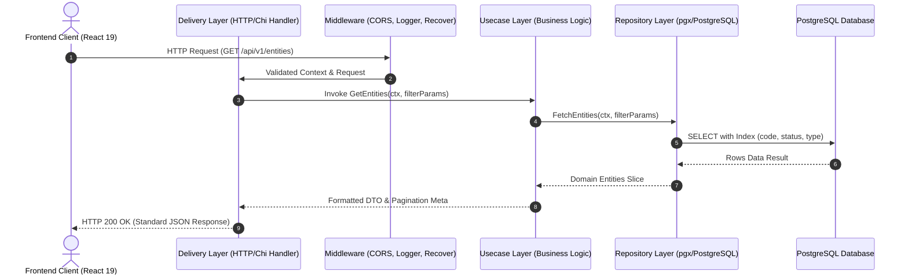
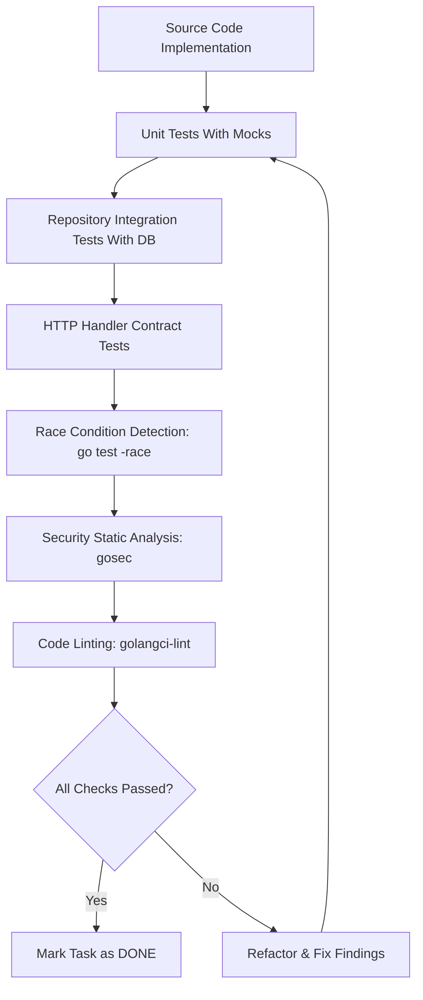
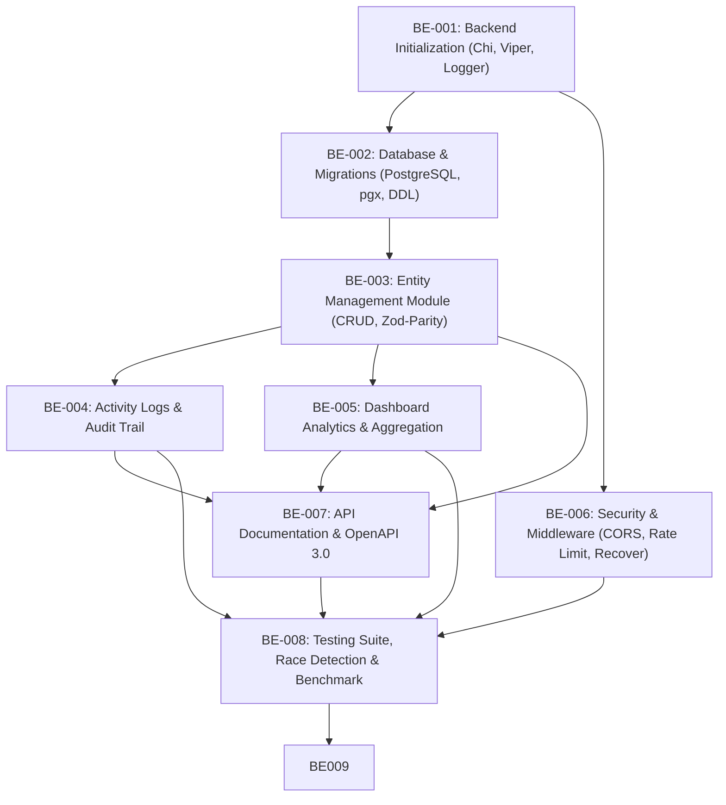

# 🧭 GeoTrack — Backend Development Task Documentation (Master Plan)

> **Document Version:** 1.0.0  
> **Target Platform:** Golang 1.23+  
> **Architecture Pattern:** Clean Architecture (Domain-Driven, Decoupled Layers)  
> **Database:** PostgreSQL 16+ (PostGIS ready / B-Tree Spatial Coordinates Indexing)  
> **Target Frontend Consumer:** GeoTrack React 19 Frontend (`http://localhost:8081`)

---

## Table of Contents
1. [A. Backend Overview](#a-backend-overview)
2. [B. Backend Architecture & Folder Structure](#b-backend-architecture--folder-structure)
3. [C. Main Task List](#c-main-task-list)
4. [D. Detailed Task Overview & File Mapping](#d-detailed-task-overview--file-mapping)
5. [E. Complete API Contract](#e-complete-api-contract)
6. [F. Security Review & Threat Mitigation](#f-security-review--threat-mitigation)
7. [G. Code Quality & Performance Review](#g-code-quality--performance-review)
8. [H. Testing Strategy & Quality Assurance](#h-testing-strategy--quality-assurance)
9. [I. Task Dependency & Implementation Order](#i-task-dependency--implementation-order)
10. [J. Final Verification Checklist & Per-Task Completion Gate](#j-final-verification-checklist--per-task-completion-gate)

---

## A. Backend Overview

### 1. Tujuan Backend
Backend **GeoTrack** bertindak sebagai fondasi layanan terpusat (*Single Source of Truth*) untuk mengelola, memvalidasi, mengamankan, dan menyajikan data entitas spasial (kendaraan, sensor IoT, fasilitas fisik, dan infrastruktur publik), statistik agregasi dashboard, serta riwayat audit aktivitas secara *real-time*.

### 2. Tanggung Jawab Utama
* **REST API Delivery:** Menyediakan antarmuka komunikasi data HTTP yang konsisten, berkecepatan tinggi, dan sesuai dengan kontrak frontend.
* **Geospatial & Entity Integrity:** Menjamin validitas titik koordinat (Latitude/Longitude), keunikan kode entitas, serta konsistensi tipe dan status.
* **Automated Activity Logging:** Mencatat setiap mutasi data (penambahan, perubahan atribut, pergantian status perangkat, dan penghapusan) ke dalam audit log secara atomik.
* **Aggregated Statistics:** Menyediakan kalkulasi metrik status secara instan tanpa membebani komputasi klien.
* **Security & Boundary Defense:** Memfilter input berbahaya (SQL Injection, XSS, Parameter Tampering), mengonfigurasi CORS policy yang ketat, dan menerapkan rate limiting.

### 3. Teknologi yang Direkomendasikan & Justifikasi Teknis

| Komponen | Pilihan Teknologi | Versi | Alasan Pemilihan & Justifikasi Teknis |
| :--- | :--- | :---: | :--- |
| **Language** | Golang | 1.23+ | Performa tinggi, kompilasi binary mandiri tanpa runtime berat, hemat memory, dan dukungan konkurensi bawaan (goroutines). |
| **HTTP Router** | `go-chi/chi/v5` | v5.1+ | Ringan, 100% kompatibel dengan standar `net/http` Go, tanpa alokasi memori berlebih, dan arsitektur middleware yang idiomatik. |
| **Database** | PostgreSQL | 16+ | RDBMS ACID handal dengan dukungan tipe numerik presisi tinggi untuk koordinat geografis dan ekstensi PostGIS di masa depan. |
| **DB Driver / Pool** | `jackc/pgx/v5` | v5.7+ | Driver PostgreSQL murni tercepat untuk Go, mendukung connection pooling berkinerja tinggi, prepared statements, dan tipe biner asli. |
| **Database Migration** | `golang-migrate/migrate` | v4.18+ | Standar industri untuk migrasi skema SQL terversi (up/down) yang dapat dijalankan via CLI maupun embedded program. |
| **Data Validation** | `go-playground/validator/v10` | v10.22+ | Validasi struct deklaratif berbasis tag dengan dukungan regex kode alfanumerik, rentang nilai koordinat, dan custom error mapping. |
| **Config Loader** | `spf13/viper` | v1.19+ | Manajemen konfigurasi aman dari file `.env`, environment variables sistem, dan default values dengan type-safety. |
| **Logging** | `rs/zerolog` | v1.33+ | Logger terstruktur JSON berkecepatan ultra-tinggi (*zero allocation*) untuk audit trail dan debugging produksi. |
| **Testing Toolkit** | `stretchr/testify` | v1.9+ | Suite asersi yang ekspresif, mock generation (`mockery`), dan kompatibel penuh dengan runner bawaan `go test`. |

### 4. Alur Komunikasi Sistem



---

## B. Backend Architecture & Folder Structure

GeoTrack menerapkan arsitektur bersih (**Clean Architecture / Hexagonal**) dengan prinsip **Dependency Rule**: *Dependency hanya boleh mengarah ke dalam (inward) menuju Domain Layer*. Domain Layer tidak boleh mengimpor framework, database driver, atau library HTTP apa pun.

```text
Backend-Geotrack/
├── cmd/
│   └── api/
│       └── main.go                     # Entry point aplikasi & dependency injection wiring
├── internal/
│   ├── config/                         # Environment & application configuration
│   │   └── config.go
│   ├── domain/                         # Pure business models, domain errors, & interfaces
│   │   ├── entity.go                   # Struct Entity, EntityType, EntityStatus, Repository interface
│   │   ├── activity.go                 # Struct Activity, ActivityType, Repository interface
│   │   ├── dashboard.go                # Struct DashboardStats, summary aggregates
│   │   └── errors.go                   # Standard domain sentinel errors
│   ├── usecase/                        # Application business logic & use cases
│   │   ├── entity_usecase.go           # Entity CRUD orchestration & coordinate validation
│   │   ├── activity_usecase.go         # Activity query & automatic logging orchestration
│   │   └── dashboard_usecase.go        # Statistical data calculation & aggregation logic
│   ├── repository/                     # Database persistence layer (PostgreSQL / pgx)
│   │   ├── postgres/
│   │   │   ├── connection.go           # pgxpool setup, health ping, & pool config
│   │   │   ├── entity_repository.go    # SQL queries for entities table (CRUD + filtering)
│   │   │   ├── activity_repository.go  # SQL queries for activities table
│   │   │   └── dashboard_repository.go # Optimized aggregation queries
│   ├── delivery/
│   │   └── http/                       # Transport layer (Chi handlers, DTO, router)
│   │       ├── router.go               # Route registration & middleware binding
│   │       ├── response.go             # Standard JSON envelope serializer (Success & Error)
│   │       ├── entity_handler.go       # HTTP handlers for /api/v1/entities
│   │       ├── activity_handler.go     # HTTP handlers for /api/v1/activities
│   │       ├── dashboard_handler.go    # HTTP handlers for /api/v1/dashboard
│   │       └── health_handler.go       # HTTP handler for /api/v1/health
│   └── middleware/                     # Cross-cutting HTTP middlewares
│       ├── cors.go                     # CORS headers for React client (localhost:8081)
│       ├── logger.go                   # Structured HTTP request/response logging
│       ├── recover.go                  # Panic recovery & error boundary
│       ├── rate_limiter.go             # Token bucket rate limiting per IP
│       └── request_id.go               # Traceable X-Request-ID propagation
├── migrations/                         # SQL Schema migrations (golang-migrate)
│   ├── 000001_create_entities_table.up.sql
│   ├── 000001_create_entities_table.down.sql
│   ├── 000002_create_activities_table.up.sql
│   ├── 000002_create_activities_table.down.sql
│   ├── 000003_seed_initial_data.up.sql
│   └── 000003_seed_initial_data.down.sql
├── pkg/                                # Reusable utilities (agnostic to business)
│   ├── validator/                      # Custom validator wrapper & rules
│   │   └── validator.go
│   └── logger/                         # Zerolog factory & configuration
│       └── logger.go
├── docs/                               # API documentation & OpenAPI specs
│   └── openapi.yaml
├── tests/                              # Integration & E2E Test Suite
│   ├── integration/                    # Database repository integration tests
│   ├── e2e/                            # Full API HTTP flow tests
│   └── testdata/                       # Seed test fixtures & mocks
├── Task/                               # Dokumentasi task development
│   ├── BACKEND_TASK.md                 # Master Task Document (File ini)
│   └── Task-Detail/                    # Detail breakdown teknis per task
│       ├── BE-001-project-initialization.md
│       ├── BE-002-database-setup-and-migrations.md
│       ├── BE-003-entity-management-module.md
│       ├── BE-004-activity-logs-module.md
│       ├── BE-005-dashboard-analytics-api.md
│       ├── BE-006-security-cors-and-middleware.md
│       ├── BE-007-api-documentation-and-contract.md
│       └── BE-008-testing-quality-and-performance.md
├── .env.example                        # Template environment variables
├── .golangci.yml                       # Linter rules & code quality configuration
├── Makefile                            # Automasi build, test, migrate, lint, & run
├── go.mod                              # Go module definition
└── go.sum                              # Checksum dependencies
```

### Aturan Dependency Antar-Layer
1. **Domain Layer:** Pusat dari sistem. Tidak boleh mengimpor layer lain (`internal/usecase`, `internal/repository`, `internal/delivery` dilarang keras diimpor di `domain`).
2. **Usecase Layer:** Bergantung hanya pada interface Domain. Memanggil Repository melalui interface abstrak.
3. **Repository Layer:** Mengimplementasikan interface Repository yang didefinisikan di Domain. Bertanggung jawab murni pada query SQL, mapping row ke struct Domain, dan penanganan database error.
4. **Delivery Layer:** Bertanggung jawab atas binding request HTTP, validasi payload, pemanggilan Usecase, dan perenderan response JSON. Tidak boleh ada query database atau business logic di layer ini.
5. **Main (`cmd/api/main.go`):** Satu-satunya tempat yang mengetahui seluruh konkrit implementasi untuk melakukan *Dependency Injection* (Wiring).

---

## C. Main Task List

| Task ID | Main Task | Scope Ringkas | Priority | Dependencies | Status | Target Output File |
| :---: | :--- | :--- | :---: | :---: | :---: | :--- |
| **BE-001** | Backend Initialization & Tooling | Inisialisasi Go module, router Chi, graceful shutdown, & config loader | High | - | `COMPLETED` | [`BE-001-project-initialization.md`](file:///Users/ptsiagaabdiutama/Test%20Software/Backend-Geotrack/Task/Task-Detail/BE-001-project-initialization.md) |
| **BE-002** | Database & Migration Architecture | Skema PostgreSQL, migrasi DDL, connection pool `pgx`, dan spatial indexing | High | BE-001 | `COMPLETED` | [`BE-002-database-setup-and-migrations.md`](file:///Users/ptsiagaabdiutama/Test%20Software/Backend-Geotrack/Task/Task-Detail/BE-002-database-setup-and-migrations.md) |
| **BE-003** | Entity Management Module (CRUD) | Domain, Repo, Usecase, & Handler CRUD entitas (filter, sort, pagination) | High | BE-002 | `COMPLETED` | [`BE-003-entity-management-module.md`](file:///Users/ptsiagaabdiutama/Test%20Software/Backend-Geotrack/Task/Task-Detail/BE-003-entity-management-module.md) |
| **BE-004** | Activity Logs & Audit Trail | Pencatatan otomatis mutasi entitas, query riwayat kronologis, & filter log | Medium | BE-003 | `COMPLETED` | [`BE-004-activity-logs-module.md`](file:///Users/ptsiagaabdiutama/Test%20Software/Backend-Geotrack/Task/Task-Detail/BE-004-activity-logs-module.md) |
| **BE-005** | Dashboard Analytics & Aggregation | Endpoint metrik total entitas, kalkulasi status dinamis, & overview payload | Medium | BE-003 | `COMPLETED` | [`BE-005-dashboard-analytics-api.md`](file:///Users/ptsiagaabdiutama/Test%20Software/Backend-Geotrack/Task/Task-Detail/BE-005-dashboard-analytics-api.md) |
| **BE-006** | Security Hardening & Middleware Suite | CORS origin 8081, IP rate limiter, recover panic, secure headers, sanitasi | High | BE-001 | `COMPLETED` | [`BE-006-security-cors-and-middleware.md`](file:///Users/ptsiagaabdiutama/Test%20Software/Backend-Geotrack/Task/Task-Detail/BE-006-security-cors-and-middleware.md) |
| **BE-007** | API Documentation & Contract | Spesifikasi OpenAPI 3.0 / Swagger, mock server contract verification | Low | BE-003, BE-004, BE-005 | `COMPLETED` | [`BE-007-api-documentation-and-contract.md`](file:///Users/ptsiagaabdiutama/Test%20Software/Backend-Geotrack/Task/Task-Detail/BE-007-api-documentation-and-contract.md) |
| **BE-008** | Testing, Race Detection & Benchmark | Unit test 80%+ coverage, race detector (`-race`), profiling, & SQL tuning | High | Seluruh Modul | `COMPLETED` | [`BE-008-testing-quality-and-performance.md`](file:///Users/ptsiagaabdiutama/Test%20Software/Backend-Geotrack/Task/Task-Detail/BE-008-testing-quality-and-performance.md) |
| **BE-009** | Frontend-Backend Integration & E2E | Wiring live API ke TanStack Start, unwrap envelope, TanStack Query, & validasi E2E | High | BE-003, BE-004, BE-005, BE-006, BE-007 | `COMPLETED` | [`BE-009-frontend-backend-integration.md`](file:///Users/ptsiagaabdiutama/Test%20Software/Backend-Geotrack/Task/Task-Detail/BE-009-frontend-backend-integration.md) |

---

## D. Detailed Task Overview & File Mapping

Setiap task diuraikan secara komprehensif pada dokumen terpisah di folder [Task-Detail/](file:///Users/ptsiagaabdiutama/Test%20Software/Backend-Geotrack/Task/Task-Detail):

1. **[BE-001 — Project Initialization & Base Configuration](file:///Users/ptsiagaabdiutama/Test%20Software/Backend-Geotrack/Task/Task-Detail/BE-001-project-initialization.md)**
   * Inisialisasi `go.mod` (`geotrack/backend`), konfigurasi Viper, router Chi v5, struktur Clean Architecture, structured logging Zerolog, dan OS Signal Graceful Shutdown (SIGINT/SIGTERM).
2. **[BE-002 — Database Design, Connection & Migrations](file:///Users/ptsiagaabdiutama/Test%20Software/Backend-Geotrack/Task/Task-Detail/BE-002-database-setup-and-migrations.md)**
   * DDL migrations untuk tabel `entities` dan `activity_logs`, composite indexes (status, type, coordinates), pgx connection pool tuning (MaxConns: 25, MinConns: 5, MaxConnIdleTime: 15m), dan seeder awal.
3. **[BE-003 — Entity Management Module](file:///Users/ptsiagaabdiutama/Test%20Software/Backend-Geotrack/Task/Task-Detail/BE-003-entity-management-module.md)**
   * Implementasi Domain, Repository, Usecase, dan HTTP Handler untuk Create, Read (List & Detail by Code), Update, dan Delete Entity. Validasi Zod-parity di Go validator.
4. **[BE-004 — Activity Logs & Automatic Audit Trail](file:///Users/ptsiagaabdiutama/Test%20Software/Backend-Geotrack/Task/Task-Detail/BE-004-activity-logs-module.md)**
   * Sistem pencatatan event otomatis (*created, updated, status_changed, deleted*) pada setiap mutasi entitas, query timeline terurut kronologis dengan filter jenis aktivitas dan pencarian entity code.
5. **[BE-005 — Dashboard Analytics & Aggregation API](file:///Users/ptsiagaabdiutama/Test%20Software/Backend-Geotrack/Task/Task-Detail/BE-005-dashboard-analytics-api.md)**
   * Query agregasi SQL berkinerja tinggi untuk menghitung total entitas, active count, inactive count, maintenance count, serta ringkasan aktivitas terbaru dalam 1 HTTP request payload.
6. **[BE-006 — Security Hardening, CORS & Middleware Suite](file:///Users/ptsiagaabdiutama/Test%20Software/Backend-Geotrack/Task/Task-Detail/BE-006-security-cors-and-middleware.md)**
   * Konfigurasi CORS ketat untuk origin frontend (`http://localhost:8081` & `http://localhost:5173`), rate limiter token bucket per client IP, panic recovery middleware, payload size limiter, dan header keamanan HTTP.
7. **[BE-007 — API Documentation & Contract Enforcement](file:///Users/ptsiagaabdiutama/Test%20Software/Backend-Geotrack/Task/Task-Detail/BE-007-api-documentation-and-contract.md)**
   * OpenAPI 3.0 specification (`openapi.yaml`), Swagger UI integration, verifikasi konsistensi JSON envelope, dan contract testing sinkronisasi frontend `axios` client.
8. **[BE-008 — Comprehensive Testing, Benchmark & Optimization](file:///Users/ptsiagaabdiutama/Test%20Software/Backend-Geotrack/Task/Task-Detail/BE-008-testing-quality-and-performance.md)**
   * Unit test coverage >= 85%, integration test dengan database PostgreSQL nyata, data race detection via `go test -race`, static security scan via `gosec`, dan benchmark handler.
9. **[BE-009 — Frontend-Backend Integration & End-to-End Connectivity](file:///Users/ptsiagaabdiutama/Test%20Software/Backend-Geotrack/Task/Task-Detail/BE-009-frontend-backend-integration.md)**
   * Menghubungkan aplikasi Frontend GeoTrack (TanStack Start, React Query, Axios) dengan backend Golang, konfigurasi `.env` `VITE_API_BASE_URL`, penyesuaian Axios envelope interceptor, migrasi state mock ke live database, dan pengujian alur E2E.

---

## E. Complete API Contract

Seluruh endpoint menggunakan format pembungkus (*JSON Envelope*) standar:

### 1. Format Envelope Response Standar

#### A. Format Sukses
```json
{
  "success": true,
  "message": "Entity retrieved successfully",
  "data": { ... },
  "meta": {
    "page": 1,
    "limit": 10,
    "total_records": 51,
    "total_pages": 6
  }
}
```

#### B. Format Error
```json
{
  "success": false,
  "error": {
    "code": "ENTITY_NOT_FOUND",
    "message": "Entity with code IOT-999 was not found",
    "details": [
      {
        "field": "code",
        "issue": "Not found in active repository"
      }
    ]
  }
}
```

---

### 2. Daftar Endpoint Lengkap

#### Modul 1: Health & System Check
| Method | Endpoint | Fungsi | Auth | Query / Body |
| :---: | :--- | :--- | :---: | :--- |
| `GET` | `/api/v1/health` | Pemeriksaan kesehatan aplikasi dan koneksi DB | None | Response status DB ping & uptime |

#### Modul 2: Dashboard Analytics
| Method | Endpoint | Fungsi | Auth | Query / Body |
| :---: | :--- | :--- | :---: | :--- |
| `GET` | `/api/v1/dashboard/stats` | Statistik total, breakdown status, & quick activity | None | Ringkasan metrik dashboard dalam 1 request |

#### Modul 3: Entity Management
| Method | Endpoint | Fungsi | Auth | Query / Body |
| :---: | :--- | :--- | :---: | :--- |
| `GET` | `/api/v1/entities` | Daftar entitas dengan filter, sort, dan pagination | None | `?search=&type=&status=&sort_by=&order=&page=&limit=` |
| `GET` | `/api/v1/entities/{code}` | Detail lengkap satu entitas berdasarkan kode | None | Path param: `code` (string) |
| `POST` | `/api/v1/entities` | Menambahkan entitas baru | None | Body: `code`, `name`, `type`, `status`, `lat`, `lng`, `description` |
| `PUT` | `/api/v1/entities/{code}` | Mengubah atribut / status / koordinat entitas | None | Body: `name`, `type`, `status`, `lat`, `lng`, `description` |
| `DELETE` | `/api/v1/entities/{code}` | Menghapus entitas & mencatat log otomatis | None | Path param: `code` (string) |

#### Modul 4: Activity Logs
| Method | Endpoint | Fungsi | Auth | Query / Body |
| :---: | :--- | :--- | :---: | :--- |
| `GET` | `/api/v1/activities` | Riwayat aktivitas kronologis terfilter | None | `?search=&type=&page=&limit=` |
| `GET` | `/api/v1/activities/stats` | Distribusi tipe aktivitas & entitas paling aktif | None | Agregasi distribusi persentase & event count |

---

## F. Security Review & Threat Mitigation

| Kategori Risiko | Potensi Ancaman | Tingkat Risiko | Strategi Mitigasi Wajib pada Backend |
| :--- | :--- | :---: | :--- |
| **SQL Injection** | Manipulasi klausa WHERE atau sorting params (`sort_by`, `search`) | **Critical** | Wajib menggunakan parameterized queries (`$1, $2`) via `pgx`. Nama kolom sorting divalidasi dengan whitelist ketat (`code`, `name`, `last_updated`). Tidak boleh ada string concatenation pada query SQL. |
| **Coordinate Tampering** | Nilai koordinat di luar batas fisik bumi atau format invalid | **High** | Validasi numerik ganda: layer handler (validator tag `min=-90,max=90`) dan database `CHECK (latitude BETWEEN -90.0 AND 90.0)` & `CHECK (longitude BETWEEN -180.0 AND 180.0)`. |
| **Broken Object Integrity** | Duplikasi Entity Code atau modifikasi kode entitas lain | **High** | Kolom `code` memiliki constraint `UNIQUE` di database. Pada saat Update, kode di path parameter diverifikasi terhadap eksistensi data lokal. |
| **DDoS / Resource Exhaustion** | Flooding query berat atau pagination dengan limit raksasa | **Medium** | Pembatasan `limit` pagination maksimal 100 per request. Menerapkan middleware Rate Limiting (Token Bucket: 60 req/menit per IP) dan HTTP Request Body Size Limit (maksimal 1 MB). |
| **CORS Misconfiguration** | Domain tidak sah mengakses API backend dari browser | **High** | Konfigurasi `cors.New` hanya mengizinkan origin terdaftar (`http://localhost:8081` dan `http://localhost:5173`), melarang wildcard `*` pada mode produksi. |
| **Information Disclosure** | Internal stack trace atau database error bocor ke klien | **Medium** | Error handling terpusat: internal error dicatat ke logger Zerolog di sisi server, sedangkan respon ke klien berupa pesan ramah pengguna dan error code baku. |

---

## G. Code Quality & Performance Review

### 1. Standar Kualitas Kode (Code Quality Standards)
* **Clean Architecture Purity:** Dilarang meletakkan SQL statement di luar folder `internal/repository/`. Dilarang meletakkan logika validasi bisnis di layer HTTP handler.
* **Error Wrapping:** Semua error yang dikembalikan dari repository atau helper dibungkus menggunakan `fmt.Errorf("context: %w", err)` untuk mempertahankan stack chain.
* **No Global Variables:** Semua state (database pool, logger, router) diinjeksikan secara eksplisit melalui constructor (`NewEntityHandler(...)`, `NewEntityUsecase(...)`).
* **Linter Compliance:** Wajib lolos seluruh aturan default `.golangci.yml` tanpa error (termasuk `errcheck`, `govet`, `staticcheck`, `unused`, `gofmt`).

### 2. Standar Performa (Performance Standards)
* **Connection Pooling:** Pool PostgreSQL dikonfigurasi optimal:
  * `MaxConns`: 25
  * `MinConns`: 5
  * `MaxConnLifetime`: 1 jam
  * `MaxConnIdleTime`: 15 menit
* **Query Indexing:** Seluruh query filter dan pencarian didukung index B-Tree pada kolom `code`, `status`, `type`, dan `last_updated`. Koordinat didukung index ganda `(latitude, longitude)`.
* **Zero Allocation JSON Logging:** Menggunakan `zerolog` untuk logging request HTTP agar tidak membebani garbage collector.
* **Goroutine Safety:** Operasi penulisan state atau background tasks aman dari race condition (wajib lolos pemeriksaan `go test -race`).

---

## H. Testing Strategy & Quality Assurance

Sesuai aturan wajib arsitektur, testing bukan sekadar dilakukan di akhir, melainkan merupakan prasyarat verifikasi penyelesaian setiap task:



### Matriks Pengujian
1. **Unit Testing (`*_test.go` berdampingan dengan source code):**
   * Menguji Domain logic, validasi input, error handling, dan Usecase logic menggunakan mock repository (`testify/mock`).
2. **Integration Testing (`tests/integration/`):**
   * Menguji operasi CRUD repository langsung terhadap database PostgreSQL pengujian (mengecek constraint unique, transaksi, dan index).
3. **HTTP API Contract Testing:**
   * Menguji handler menggunakan `net/http/httptest` untuk memastikan status code HTTP, header, dan struktur JSON envelope sesuai kontrak frontend.
4. **Race Condition Testing:**
   * Dijalankan pada seluruh paket menggunakan perintah `go test -race ./...`.
5. **Security Static Analysis:**
   * Audit keamanan kode statis dijalankan menggunakan tool `gosec ./...`.

---

## I. Task Dependency & Implementation Order



### Urutan Pengerjaan:
1. **Fase Fondasi:** Kerjakan **BE-001** (Inisialisasi) dilanjutkan **BE-002** (Database & Migrations).
2. **Fase Middleware & Keamanan:** **BE-006** dapat mulai dirancang paralel setelah BE-001 siap.
3. **Fase Inti Bisnis:** Kerjakan **BE-003** (Modul Entitas) sebagai modul utama.
4. **Fase Agregasi & Audit:** Setelah BE-003 selesai, kerjakan **BE-004** (Activity Logs) dan **BE-005** (Dashboard Analytics).
5. **Fase Pengujian & Dokumentasi:** Eksekusi **BE-007** (OpenAPI Contract) dan finalisasi **BE-008** (Comprehensive Testing & Performance Benchmark).
6. **Fase Integrasi Frontend-Backend:** Eksekusi **BE-009** untuk mengintegrasikan seluruh live API ke frontend TanStack Start, mengaktifkan live query cache, dan verifikasi alur bisnis end-to-end.

---

## J. Final Verification Checklist & Per-Task Completion Gate

### Checklist Kesiapan Integrasi Frontend-Backend

#### 1. Arsitektur & Struktur
- [ ] Folder Clean Architecture terstruktur rapi tanpa circular dependency.
- [ ] Handler tidak mengandung business logic atau query SQL langsung.
- [ ] Domain layer 100% bebas dari dependency framework atau database driver.

#### 2. Database & Migrasi
- [ ] Tabel `entities` dan `activity_logs` berhasil di-migrasi via script up/down.
- [ ] Constraint `UNIQUE` pada kolom `code` aktif.
- [ ] Check constraint validitas koordinat Latitude (`-90` s/d `90`) dan Longitude (`-180` s/d `180`) aktif di database.
- [ ] Index pencarian dan filter aktif.

#### 3. API Contract & Kesesuaian Frontend
- [ ] Seluruh endpoint mengembalikan JSON envelope (`success`, `data`, `meta`, `error`).
- [ ] Error response memuat kode error dan rincian field yang tidak valid.
- [ ] Pagination parameter (`page`, `limit`) dan metadata pagination berfungsi akurat.
- [ ] Filter multi-kriteria (`type`, `status`, `search`) berfungsi konsisten.

#### 4. Keamanan & Performa
- [ ] CORS teruji mengizinkan request dari `http://localhost:8081`.
- [ ] Rate limiter aktif melindungi endpoint publik.
- [ ] Query SQL menggunakan parameterisasi `$1, $2` (kebal SQL Injection).
- [ ] Tidak ada informasi internal/stack trace yang bocor ke respon klien saat error 500.

#### 5. Pengujian & Kualitas Kode
- [ ] Unit test minimal 80% code coverage tercapai.
- [ ] `go test -race ./...` lulus tanpa race condition warning.
- [ ] `golangci-lint run` lulus dengan 0 error.
- [ ] `gosec ./...` lulus tanpa temuan high/critical vulnerability.

---

> **Langkah Selanjutnya:**  
> Buka masing-masing file di folder [Task-Detail/](file:///Users/ptsiagaabdiutama/Test%20Software/Backend-Geotrack/Task/Task-Detail) untuk melihat rincian teknis mendalam sebelum memulai coding pada task terkait.

